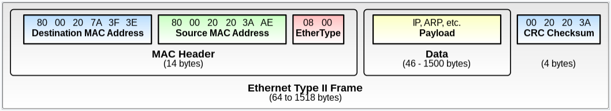

## 1 Ethernet

- 이더넷은 LAN에서 일반적으로 사용되는 유선 컴퓨터 네트워킹 기술이다.
- 2계층(OSI Model)에 속하는 프로토콜이다
- 하나의 네트워크 대역인 LAN에서 통신할 때 사용되며 다른 네트워크 대역과 통신하려면 3계층(OSI Model)이 개입되어야 한다

## 2 Ethernet의 주소 체계

- Ethernet은 MAC 주소를 사용한다
- MAC 주소는 6byte(48비트)의 크기를 가짐
  - 전반부 절반인 24비트는 **OUI**(Organizationally Unique Identifier)이다
  - OUI는 네트워크 인터페이스 장치 제조사가 IEEE에 신청해서 받는다
  - 따라서 MAC 주소를 보면 네트워크 인터페이스 장치의 제조사를 알 수 있다
- MAC 주소는 로컬 네트워크 내의 식별자이다
  - 로컬 네트워크 내에서 MAC 주소가 중복되면 통신에 문제가 발생한다
- MAC 주소와 IP 주소의 대응표를 **ARP 테이블**이라고 하며, 통신할 때 이를 이용한다
  - [ARP.md](../ARP/ARP.md)
- MAC 주소는 네트워크 장치별로 설정되어 있지만, 해당 주소가 반드시 그 네트워크 장비를 가리키는 것은 아니다
  - 소프트웨어적으로 MAC 주소를 변경할 수 있다
- MAC 주소가 물리 장치에 고정되어 있으면 주소를 추적해 장치와 장치 소유자를 추적할 수 있어 프라이버시 문제가 생긴다
  - 이를 막기 위해 Android와 iOS는 접속하는 네트워크 단위별로 별도의 MAC 주소를 생성해 사용하는 기능을 제공한다
  - 이를 MAC 주소 무작위화(Randomization)라고 한다

## 3 Ethernet의 Frame 구조

- Frame은 Header, Payload(Data), Footer로 구성된다

### 3.1 Header

- Header는 목적지 주소, 출발지 주소, EtherType을 가지고 있다

**destination and source MAC addresses**

- 헤더에는 목적지 주소와 출발지 주소 정보를 가지고 있다
- 여기서 주소는 MAC 주소를 말한다
- 주소당 6바이트

**EtherType**

- 상위 프로토콜이 무엇인지 알려주는 역할을 한다
- 2바이트
- 예시
  - `0x0800`: IP
  - `0x0806`: ARP
