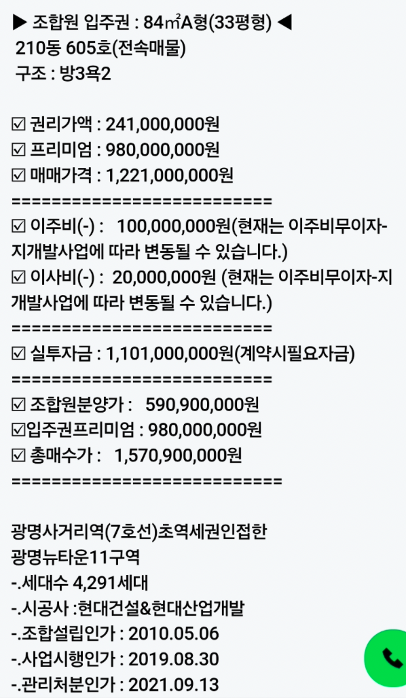

## 1. 입주권이란?

- 입주권(정식 명칭: 조합원 입주권)은 재개발·재건축 등 정비사업 구역 내 토지 또는 건축물을 소유한 사람이 사업 완료 후 **새 아파트에 입주할 수 있는 지위**를 말합니다.
- 부동산(토지·건물) 자체가 아니라 **"입주자로 선정된 지위"라는 권리**를 사고파는 것이라는 점이 일반 부동산 매매와 다릅니다.
- 법적 근거는 [도시 및 주거환경정비법](https://www.law.go.kr/%EB%B2%95%EB%A0%B9/%EB%8F%84%EC%8B%9C%EB%B0%8F%EC%A3%BC%EA%B1%B0%ED%99%98%EA%B2%BD%EC%A0%95%EB%B9%84%EB%B2%95)이며, 같은 법 제39조는 정비사업 조합원의 자격을 원칙적으로 구역 내 **"토지 또는 건축물의 소유자"**로 정하고 있습니다.

:::info[입주권은 언제 생기나요?]

- 조합원 입주권은 **관리처분계획 인가**가 떨어지는 시점에 발생합니다.
- 관리처분계획 인가 전까지는 "재개발 구역 내 부동산(토지·건물)"을 산 것이고, 인가 이후에는 그 부동산이 멸실되면서 "입주권"이라는 권리로 전환됩니다.

:::

## 2. 입주권 vs 분양권

| 구분 | 조합원 입주권 | 분양권 |
|---|---|---|
| 취득 방식 | 정비구역 내 부동산 소유 → 관리처분인가 | 청약 당첨 → 공급계약 체결 |
| 권리 확정 | 관리처분계획 인가 시 확정 | 분양계약서로 확정 |
| 추가 비용 | 공사비 변동 등에 따른 **추가 분담금** 발생 가능 | 분양가로 확정, 추가 분담금 없음 |
| 가격 구성 | 권리가액 + 프리미엄(+분담금) | 분양가 + 프리미엄(웃돈) |

## 3. 정비사업 절차와 입주권

정비사업은 다음 순서로 진행되며, 입주권은 **관리처분계획 인가** 단계에서 생깁니다.

```text
정비구역 지정 → 조합설립인가 → 사업시행인가 → 관리처분계획인가
→ 이주·철거 → 착공 → 준공 → 이전고시 → 청산(조합 해산)
```

- **조합설립인가**: 토지등소유자들이 조합을 결성해 사업 시행 주체가 되는 단계
- **사업시행인가**: 건축계획, 세대수 등 사업의 구체적 내용이 확정되는 단계
- **관리처분계획인가**: 조합원별로 어떤 평형을 배정받고 분담금(또는 환급금)이 얼마인지 확정하는 단계 — **이 인가가 나야 입주권이 생깁니다.**
- **이주·철거·착공**: 관리처분인가 이후 기존 주택을 비우고(이주) 철거·공사가 시작됩니다.

## 4. 입주권 가격을 구성하는 요소

| 용어 | 의미 |
|---|---|
| 종전자산 감정평가액 | 관리처분계획 수립을 위해 조합원이 갖고 있던 기존 부동산을 감정평가한 금액 |
| 비례율 | 사업 수익성을 나타내는 지표. (종후자산평가액 − 총사업비) ÷ 종전자산평가액 × 100 |
| 권리가액 | 조합원이 실제로 인정받는 자산가치. **권리가액 = 종전자산 감정평가액 × 비례율** |
| 조합원분양가 | 조합원이 새 아파트를 분양받는 가격(일반분양가보다 저렴한 것이 보통) |
| 분담금(추가부담금) | **조합원분양가 − 권리가액.** 권리가액보다 분양가가 높으면 추가로 내야 할 돈, 낮으면 환급받는 돈 |
| 프리미엄(P) | 입주권 매매 시 매도자가 권리가액 위에 추가로 요구하는 웃돈 |
| 이주비 | 이주 기간 동안 조합(시공사)이 조합원에게 빌려주는 돈. 매도자가 이미 받은 경우 매수자가 그 채무를 승계 |
| 이사비 | 이주 시 지급되는 이사 비용 지원금. 이주비와 마찬가지로 승계 대상 |

:::warning[이주비·이사비는 사업장마다 다릅니다]

- 이주비·이사비의 금액, 무이자 여부는 **조합·시공사·사업장마다 다르며 사업 진행에 따라 변동될 수 있습니다.**
- 매물 정보지에 적힌 이주비 조건은 계약 시점에 조합 사무실 등을 통해 반드시 재확인해야 합니다.

:::

## 5. 실투자금 계산 방법 — 단계별 설명

아래는 실제 매물 정보를 예시로, 계약 시 실제로 필요한 자금(실투자금)이 어떻게 계산되는지 단계별로 설명합니다. 매물은 [광명뉴타운 11구역(광명 힐스테이트)](../재개발/광명뉴타운/광명뉴타운.md) 84㎡A형(33평형) 전속매물입니다.



```text
권리가액        : 241,000,000원
프리미엄        : 980,000,000원
이주비(-)       : 100,000,000원
이사비(-)       :  20,000,000원
조합원분양가    : 590,900,000원
```

### 5.1 1단계 — 매매가격(입주권 매입가) 구하기

입주권 매매가격은 **조합원이 인정받는 권리가액에, 매도자가 요구하는 프리미엄을 더한 값**입니다.

```text
매매가격 = 권리가액 + 프리미엄
        = 241,000,000 + 980,000,000
        = 1,221,000,000원
```

### 5.2 2단계 — 승계받는 이주비·이사비 차감하기

매도자가 조합(시공사)으로부터 이미 받아 쓴 이주비·이사비는 **매수자가 그대로 채무를 승계**합니다. 따라서 매수자는 그만큼을 매도자에게 지급하지 않고, 계약금·잔금으로 낼 돈에서 뺄 수 있습니다.

```text
실투자금(계약 시 필요자금) = 매매가격 − 이주비 − 이사비
                        = 1,221,000,000 − 100,000,000 − 20,000,000
                        = 1,101,000,000원
```

:::info[실투자금 = 계약 시 필요자금]

- 실투자금은 "지금 당장 매도자에게 치러야 하는 돈"입니다.
- 승계한 이주비·이사비는 없어지는 것이 아니라 **훗날 조합에 갚아야 할 채무**로 남습니다(통상 준공·입주 시 청산).

:::

### 5.3 3단계 — 향후 추가로 낼 분담금 확인하기

입주권은 매매가격을 다 냈다고 끝나는 게 아니라, **조합원분양가와 권리가액의 차액**을 공사 진행에 따라 추가로 납부해야 합니다.

```text
분담금 = 조합원분양가 − 권리가액
      = 590,900,000 − 241,000,000
      = 349,900,000원
```

### 5.4 4단계 — 최종 총매수가(총 지불 금액) 구하기

결국 입주 시점까지 매수자가 지불하는 총금액은, **매매가격에 분담금을 더한 것**이며, 이는 **조합원분양가에 프리미엄을 더한 것**과 같습니다.

```text
총매수가 = 매매가격 + 분담금
        = 1,221,000,000 + 349,900,000
        = 1,570,900,000원

(검산) 총매수가 = 조합원분양가 + 프리미엄
              = 590,900,000 + 980,000,000
              = 1,570,900,000원
```

### 5.5 정리

| 단계 | 계산식 | 금액 |
|---|---|---|
| ① 매매가격 | 권리가액 + 프리미엄 | 1,221,000,000원 |
| ② 실투자금(계약 시 필요자금) | 매매가격 − 이주비 − 이사비 | 1,101,000,000원 |
| ③ 분담금(향후 납부) | 조합원분양가 − 권리가액 | 349,900,000원 |
| ④ 총매수가(최종 총지불액) | 매매가격 + 분담금 = 조합원분양가 + 프리미엄 | 1,570,900,000원 |

:::note[핵심 요약]

- **지금 당장 필요한 돈**은 ②실투자금(1,101,000,000원)입니다.
- **최종적으로 부담하는 총금액**은 ④총매수가(1,570,900,000원)이며, 그 차이(③분담금)는 착공·준공 등 사업 진행 단계에 맞춰 나중에 납부합니다.
- 승계한 이주비·이사비(대여금 성격)는 준공 후 조합에 상환해야 하는 채무이므로, 실투자금이 적다고 총 투자 부담이 줄어드는 것은 아닙니다.

:::

## 6. 투자 시 주의사항

- **분담금은 확정 금액이 아닙니다.** 공사비 상승, 비례율 변동 등에 따라 관리처분계획이 변경되면 분담금이 늘어날 수 있습니다.
- **이주비·이사비 조건 변동**: 정비사업 진행 상황에 따라 무이자 여부, 금액이 바뀔 수 있으므로 계약 전 조합에 재확인이 필요합니다.
- **취득세**: 입주권 매수 시에는 원칙적으로 토지분(대지지분)에 대한 취득세만 부담하고, 건물이 준공된 뒤 건물분 취득세를 추가로 납부합니다.
- **양도소득세**: 입주권은 조정대상지역 여부, 보유·거주 기간, 1세대 1주택 비과세 특례 요건 등에 따라 과세 방식이 달라지므로 매도·매수 전 세무사 등 전문가 확인이 필요합니다.

## 참고자료

- [도시 및 주거환경정비법](https://www.law.go.kr/%EB%B2%95%EB%A0%B9/%EB%8F%84%EC%8B%9C%EB%B0%8F%EC%A3%BC%EA%B1%B0%ED%99%98%EA%B2%BD%EC%A0%95%EB%B9%84%EB%B2%95) - 국가법령정보센터
- [도시 및 주거환경정비법 제39조(조합원의 자격 등)](https://casenote.kr/%EB%B2%95%EB%A0%B9/%EB%8F%84%EC%8B%9C_%EB%B0%8F_%EC%A3%BC%EA%B1%B0%ED%99%98%EA%B2%BD%EC%A0%95%EB%B9%84%EB%B2%95/%EC%A0%9C39%EC%A1%B0) - CaseNote
- [재개발·재건축 조합원 입주권 양수 시 확인 사항](https://magazine.hankyung.com/business/article/202511131708b) - 한경 매거진, 법으로 읽는 부동산
- [분양권, 입주권 차이는? 매매 방법, 양도세, 대출](https://kbthink.com/house/presale-rights.html) - KB Think
- [분양권과 입주권, 뭐가 다른가요?](https://r114.com/trends/wiki/redevelopment/3b84a6fa-284b-80e1-86bc-fc39de0eaa2e) - 부동산114
- [재개발 조합원 분담금 계산 방법 총 정리(권리가액·비례율·추가분담금)](https://law.kimnyeosa.com/%EC%9E%AC%EA%B0%9C%EB%B0%9C-%EC%A1%B0%ED%95%A9%EC%9B%90-%EB%B6%84%EB%8B%B4%EA%B8%88-%EA%B3%84%EC%82%B0-%EB%B0%A9%EB%B2%95-%EC%B4%9D-%EC%A0%95%EB%A6%AC-%EA%B6%8C%EB%A6%AC%EA%B0%80%EC%95%A1%C2%B7/) - 법률 놀이터
- [재개발(재건축)시 감정평가와 비례율, 권리가액, 분담금은?](https://building-buy.com/entry/%EC%9E%AC%EA%B0%9C%EB%B0%9C%EC%9E%AC%EA%B1%B4%EC%B6%95%EC%8B%9C-%EA%B0%90%EC%A0%95%ED%8F%89%EA%B0%80%EC%99%80-%EB%B9%84%EB%A1%80%EC%9C%A8-%EA%B6%8C%EB%A6%AC%EA%B0%80%EC%95%A1-%EB%B6%84%EB%8B%B4%EA%B8%88%EC%9D%80) - 건물사자
- [광명뉴타운 11구역(광명 힐스테이트)](../재개발/광명뉴타운/광명뉴타운.md) - 이 블로그 내 문서
